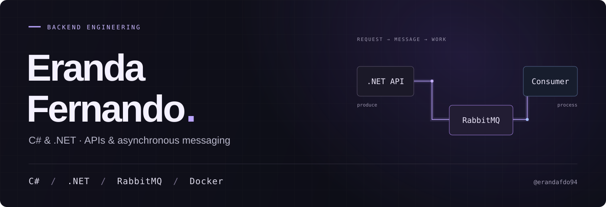

  

 

C# and .NET are my home base. I build APIs, work with asynchronous messaging, and make tools that solve everyday problems.

### The backend workbench

**APIs & services** &nbsp; / &nbsp; C# · .NET  
**Asynchronous messaging** &nbsp; / &nbsp; RabbitMQ · producer/consumer workflows  
**Development workflow** &nbsp; / &nbsp; Docker · Git

 

### Beyond the backend

Some problems are small enough to build the solution yourself.

| Project | What it does |
| :--- | :--- |
| [**Focus Shield**](https://github.com/erandafdo94/focus-shield) | A native macOS app that blocks distracting apps and websites during timed focus sessions. |
| [**DelayGate**](https://github.com/erandafdo94/delaygate) | A Chrome extension that adds a pause before opening distracting websites. |

 

Backend code and experiments are mostly in private repositories.
